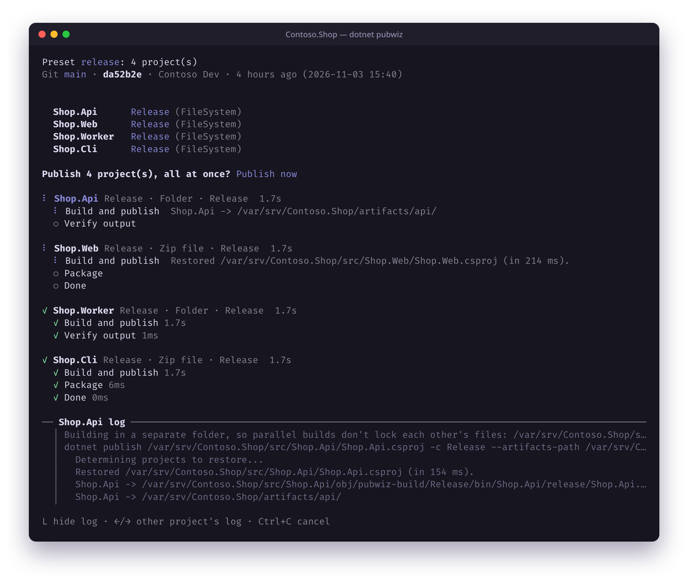
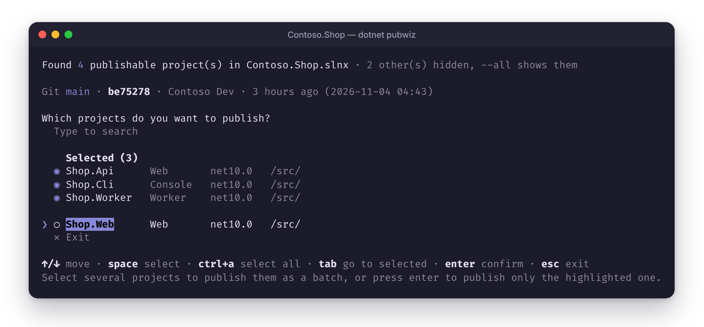
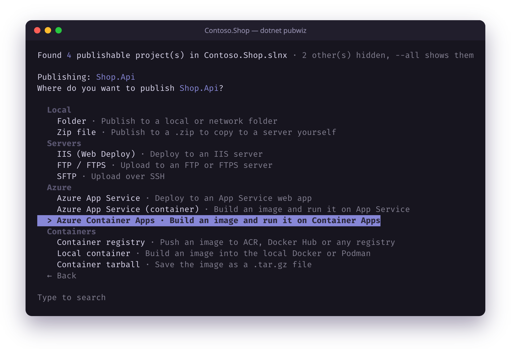
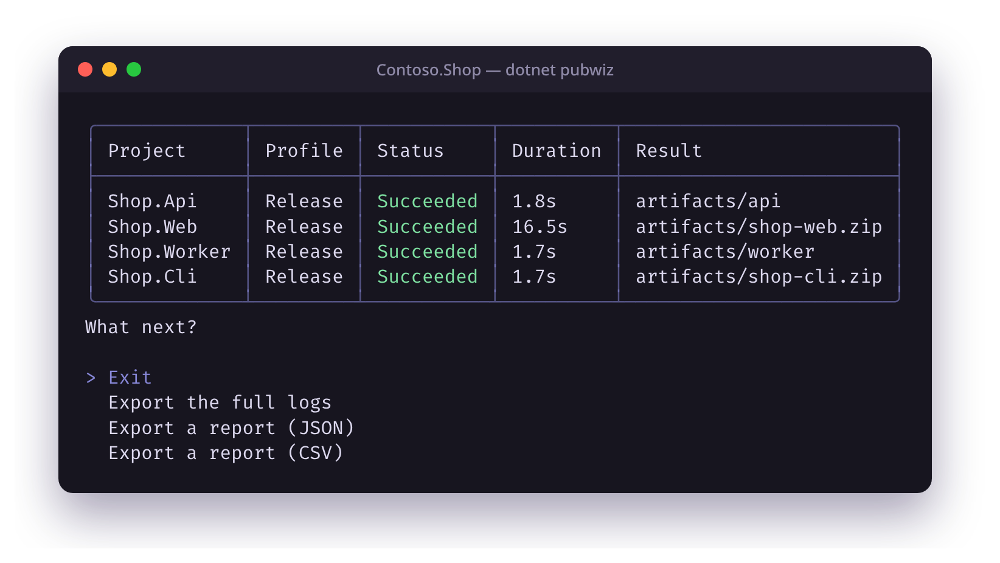

<p align="center">
  
</p>

<h1 align="center">Pubwiz</h1>

<p align="center">
  <b>The publish wizard for .NET.</b><br>
  Pick your projects and where they go. Pubwiz does the rest.
</p>

<p align="center">
  <a href="https://www.nuget.org/packages/Pubwiz"></a>
  <a href="https://www.nuget.org/packages/Pubwiz"></a>
  <a href="https://github.com/SaifAqqad/Pubwiz/actions/workflows/build.yml"></a>
  
  <a href="LICENSE"></a>
</p>

<p align="center">
  
</p>

> [!NOTE]
> Pubwiz is in early development. Bug reports are very welcome.

## Features

- Finds the solutions and projects in your folder
- Uses your existing `.pubxml` profiles, or imports `.publishsettings`
- Publishes several projects at once, with live progress
- Saves batches as presets you can commit and run in CI
- Keeps passwords in your OS keychain, or gets them from Azure for App Service profiles
- Shows your git branch, last commit and commits waiting to be pulled before you publish

## Install

Pubwiz is a [.NET tool](https://learn.microsoft.com/dotnet/core/tools/global-tools). It needs the [.NET 10 SDK](https://dotnet.microsoft.com/download) or later.

```bash
dotnet tool install -g Pubwiz
```

Update it later with `dotnet tool update -g Pubwiz`.

## Quick start

Run it in a folder with a solution or project:

```bash
dotnet pubwiz
```

**1. Pick the projects.** Type to search, press <kbd>Space</kbd> to select several for a batch (<kbd>Ctrl</kbd>+<kbd>A</kbd> selects all), or <kbd>Enter</kbd> to publish just the highlighted one.

<p align="center"></p>

**2. Pick a profile for each one**, or create one. New profiles start from a target, grouped by where the app is going:

<p align="center"></p>

Every list can be searched by typing. <kbd>Esc</kbd> or <kbd>Ctrl</kbd>+<kbd>C</kbd> in the later steps goes back to the project list.

**3. Watch it publish**, then export the logs or a report if you need them:

<p align="center"></p>

## Targets

- **Local:** folder, zip file
- **Servers:** IIS (Web Deploy, from Windows, Linux and macOS), FTP/FTPS, SFTP (with commands to run over SSH before and after uploading)
- **Azure:** App Service, Function Apps, WebJobs, Container Apps, Static Web Apps (Blazor WebAssembly)
- **AWS:** Elastic Beanstalk (Linux and Windows), ECS (with ECR), Lambda
- **Containers:** Docker/Podman, tarball, any registry
- **Mobile:** Android (`.aab`, `.apk`), iOS (`.ipa`, macOS only)

Azure targets sign in with the [Azure CLI](https://learn.microsoft.com/cli/azure/install-azure-cli) or use a `.publishsettings` file. AWS targets use the [AWS CLI](https://docs.aws.amazon.com/cli/latest/userguide/getting-started-install.html) and its sign-in (`aws configure sso`, `aws sso login` or `aws configure`); the wizard offers to set it up. Dockerfile builds need Docker or Podman.

## Commands

| Command | Description |
|---|---|
| `dotnet pubwiz [path]` | Pick projects and profiles, then publish. `path` can be a folder, solution or project. |
| `dotnet pubwiz --preset <name>` | Publish a saved preset without the wizard. |
| `dotnet pubwiz --project <name> --profile <name>` | Publish specific projects without the wizard (`--project` is repeatable). |
| `dotnet pubwiz transform [path]` | Write the transformed `web.config` a publish would produce, without publishing. |
| `dotnet pubwiz presets list` | Show the presets in `pubwiz.json`. |
| `dotnet pubwiz presets export <name>` | Write one preset to its own file, to run with `--preset-file`. |
| `dotnet pubwiz servers set <server>` | Save a Web Deploy user name and password for a server; profiles for it use them instead of their own. |
| `dotnet pubwiz servers list` / `remove <server>` | Show or forget the saved server logins. |

<details>
<summary><b>All publish options</b></summary>

| Option | Description |
|---|---|
| `-c`, `--configuration` | Build configuration, overriding the profiles' (e.g. `Release` or `Debug`). |
| `--preset <NAME>` | Run a saved preset from `pubwiz.json`. |
| `--preset-file <FILE>` | The preset file to use (default: `pubwiz.json` in the folder or its parents). |
| `--project <NAME>` | Publish this project (name or `.csproj` path) without the wizard; repeatable. Needs `--profile`. |
| `--profile <NAME>` | The publish profile used with `--project`. |
| `-y`, `--yes` | Don't ask for confirmation, and skip the menu after publishing. |
| `--all` | Also list projects that normally aren't published (libraries, tests, Aspire AppHosts). |
| `--parallel <N>` | How many projects to publish at the same time (default 1, or the preset's). The wizard asks when you pick several projects. Parallel jobs build in their own folder (`obj/pubwiz-build/<profile>`), so projects that share a library don't lock each other's files. |
| `--no-app-offline` | Keep IIS apps running while publishing. By default Web Deploy takes the app offline with `app_offline.htm` so locked files can be replaced (FTP/SFTP follow their profile). |
| `--what-if` | Build, then only show what Web Deploy would change on the server (adds, updates, deletes), without deploying. Other targets fail with a message. |
| `--show-log` | Show live build output while publishing (toggle with <kbd>L</kbd>). |
| `--log-lines <N>` | How many lines of live output to show per project (default 10). |
| `--report <FILE>` | Write a report after publishing (`.json` or `.csv`). |
| `--log-dir <FOLDER>` | Write each project's full log to this folder. |
| `--verbose` | Use detailed build output. |

</details>

## Presets

Presets save a batch of projects and profiles, so the next publish is one command. Save one from the wizard: choose **Save a profile as a preset** in a project's profile list, or **Save this selection as a preset** before publishing several projects. They're stored in `pubwiz.json` next to your solution:

```json
{
  "presets": {
    "release": {
      "configuration": "Release",
      "parallel": 4,
      "projects": [
        { "path": "src/Shop.Api/Shop.Api.csproj", "profile": "Production" },
        { "path": "src/Shop.Worker/Shop.Worker.csproj", "profile": "Production-WebJob" }
      ]
    }
  }
}
```

```bash
dotnet pubwiz --preset release
```

When a `pubwiz.json` exists, the wizard also offers its presets before asking for projects.

## CI and automation

Without a terminal (or with `CI=true`), Pubwiz never prompts. Tell it what to publish with a preset or with `--project` and `--profile`:

```bash
dotnet pubwiz --preset release --yes --report artifacts/publish.json --log-dir artifacts/logs
dotnet pubwiz --project Shop.Api --project Shop.Worker --profile Staging --yes
```

- **Passwords** are read from `PUBWIZ_PASSWORD_<PROFILE>` (the profile name in upper case, other characters as `_`), then `PUBWIZ_PASSWORD`, then Azure (for App Service profiles, with `az`), then the OS keychain.
- **Azure** profiles sign in with `az`; in CI, use `az login --service-principal` or a workload identity.
- **Exit codes:** `0` success, `1` a publish failed, `2` a required tool is missing, `3` invalid input, `130` cancelled.

## Passwords and secrets

Pubwiz never writes passwords into profiles. When a target needs one, it asks once and can save it in your OS keychain: `libsecret` on Linux, the Keychain on macOS, and Credential Manager on Windows. When a password is saved, publishing asks whether to use it; choose **No** to remove it from the keychain and enter another (e.g. after it changed on the server). With `--yes`, the saved password is used without asking.

For Azure App Service profiles that use publishing credentials (Zip Deploy, or Web Deploy to an App Service, e.g. from Visual Studio or a `.publishsettings` file), Pubwiz gets the password from Azure with the signed-in `az` instead of asking.

### Web Deploy logins per server

To sign in to an IIS server with your own login, whatever the profiles in the repository say, save it once for the server:

```bash
dotnet pubwiz servers set 10.0.0.5 --user deploy
```

Every Web Deploy profile whose `MSDeployServiceURL` points at that server (by IP address or name, as written in the profile; any port) then signs in with that user and password, instead of the profile's, with both msdeploy.exe and the built-in client. Profiles that sign in as the current Windows user can then publish from Linux and macOS too. The user name is kept in `servers.json` in your config folder (`~/.config/pubwiz` on Linux, `%APPDATA%\pubwiz` on Windows) and the password in the OS keychain. For setup scripts, pass `--password-stdin`.

## IIS (Web Deploy)

Pubwiz uses the official `msdeploy.exe` where it's installed (Windows with Web Deploy) and its own client everywhere
else, with the same settings from the profile:

| Profile setting | Effect |
|---|---|
| `SkipExtraFilesOnServer` | `true` keeps files on the server that aren't part of the app; `false` deletes them. |
| `MSDeployUseChecksum` | `true` compares files by checksum instead of size and date, so unchanged files aren't copied again. The built-in client does this for files up to 64 KB and always copies larger ones. |
| `MsDeploySkipRules` items | Files or folders to leave alone, as Visual Studio writes them (example below: keep uploads while deleting other extra files). |
| `AllowUntrustedCertificate` | Accepts the server's self-signed certificate (Pubwiz also asks when it isn't trusted). |

```xml
<ItemGroup>
  <MsDeploySkipRules Include="KeepUploads">
    <ObjectName>dirPath</ObjectName>
    <AbsolutePath>wwwroot\\uploads$</AbsolutePath>  <!-- a regular expression: \\ is one backslash -->
    <SkipAction>Delete</SkipAction>                 <!-- optional: only never delete -->
  </MsDeploySkipRules>
</ItemGroup>
```

The app is taken offline (`app_offline.htm`) while copying unless you pass `--no-app-offline`, and `--what-if` shows
the changes without making them.

## Linux and Windows servers over SSH

SFTP profiles can run a command on the server before uploading and another one after, e.g. to stop and restart the
app's service. The wizard asks for them; in a profile they're `PubwizSshPreDeployCommand` and `PubwizSshPostDeployCommand`:

```xml
<PubwizSshPreDeployCommand>sudo systemctl stop shop</PubwizSshPreDeployCommand>
<PubwizSshPostDeployCommand>sudo systemctl restart shop</PubwizSshPostDeployCommand>
```

They use the same login as the upload and run in the server's own shell: bash or sh on Linux, cmd or PowerShell on
Windows (whichever OpenSSH is set up with). `$(ProjectName)`, `$(Configuration)` and the other MSBuild variables are
filled in first; anything else, like `$(whoami)`, is left for the shell. Their output goes to the log, and a non-zero
exit code fails the publish. `sudo` can't ask for a password, so allow the command without one (`NOPASSWD` in sudoers).

## AWS

Pubwiz deploys to resources that already exist, picked in the wizard from your account:

| Target | What a publish does |
|---|---|
| Elastic Beanstalk | Zips the app, uploads it to Elastic Beanstalk's S3 bucket as a new application version, deploys it and follows the environment's events until it's Ready. Windows Server environments get an `aws-windows-deployment-manifest.json` (unless the app has one), and self-contained Linux apps a `Procfile`. |
| ECS | Builds the image, pushes it to an ECR repository (signing in with `aws ecr get-login-password`), registers a new revision of the service's task definition with the image, and waits for the rollout. |
| Lambda | Publishes for Linux on the function's architecture, zips the app (a `bootstrap` executable for custom runtimes such as Native AOT) and updates the function's code. |

Profiles keep the AWS CLI profile and region (`PubwizAwsProfile`, `PubwizAwsRegion`), so they need no password. Pushing
to ECR from any container profile signs in through the AWS CLI too. Lambda projects (`AWSProjectType` set to `Lambda`,
or the Lambda packages) are listed with the other projects.

## Azure Static Web Apps

Blazor WebAssembly apps can be deployed to a Static Web App without Node or the SWA CLI: Pubwiz does what `swa deploy`
does. It gets the app's deployment token from `az`, downloads Microsoft's uploader (StaticSitesClient, checked against
its published SHA-256 hash and shared with the SWA CLI in `~/.swa/deploy`), and uploads the site's files. When the app
has no `staticwebapp.config.json`, one is added so that the app's routes work when opened directly. Set
`PubwizStaticWebAppEnvironment` to deploy a preview environment instead of production. In CI without `az`, set
`PubwizAzureAuthentication` to `DeploymentToken` and pass the token in `PUBWIZ_PASSWORD`.

## web.config transforms

Publishing runs `dotnet publish`, so the .NET SDK applies your `web.config` transforms as usual: `web.<Configuration>.config`, `web.<Profile>.config`, `web.<Environment>.config`, then the profile's `.transform` file.

To preview the result without publishing, Run:
```bash
dotnet pubwiz transform --configuration Release --print
```

## Contributing

Issues and pull requests are welcome. To build and test:

```bash
dotnet build Pubwiz.slnx
dotnet test --solution Pubwiz.slnx
```

| Project | Contents |
|---|---|
| [`src/Pubwiz.Tool`](src/Pubwiz.Tool) | The `dotnet pubwiz` command line app: the wizard, prompts and live dashboard ([Spectre.Console](https://spectreconsole.net)) |
| [`src/Pubwiz.Core`](src/Pubwiz.Core) | The publishing logic, organized along a publish ([layout guide](src/Pubwiz.Core/README.md)) |
| [`src/Pubwiz.WebDeploy`](src/Pubwiz.WebDeploy) | A cross-platform Web Deploy client, published as its own package |
| [`tests`](tests) | Unit and integration tests (xUnit v3) |

The [Core layout guide](src/Pubwiz.Core/README.md) walks through how a publish flows through the code and how to add a new target.

## License

Pubwiz is free and unencumbered software released into the public domain. See [LICENSE](LICENSE).
