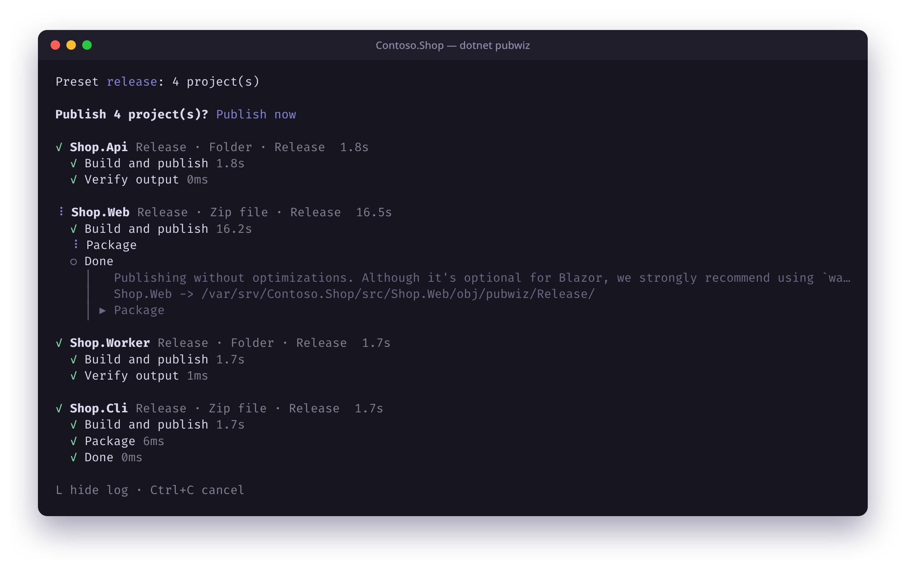

# Pubwiz

**The publish wizard for .NET.** Pick your projects and where they go. Pubwiz does the rest.



## Install

Requires the .NET 10 SDK or later.

```bash
dotnet tool install --global Pubwiz
```

## Use it

Run it in a folder with a solution or project, then pick the projects and a publish profile for each:

```bash
dotnet pubwiz
```

- **Real publish profiles:** ordinary `.pubxml` files that Visual Studio and `dotnet publish` understand. Import a `.publishsettings` or `.pubxml`, or create one in the wizard.
- **Batches:** publish several projects one after another or in parallel, with a live checklist and an optional log tail.
- **Presets:** save a batch to `pubwiz.json` and run it with `dotnet pubwiz --preset release`.
- **CI ready:** no prompts without a terminal, passwords from environment variables, JSON/CSV reports and exit codes.

## Targets

| Target | Notes |
|---|---|
| Folder, Zip file | Any OS |
| IIS (Web Deploy) | Windows, with Web Deploy installed |
| FTP / FTPS, SFTP | Any OS; can take the app offline while uploading |
| Azure App Service, Function Apps, WebJobs | Kudu zip deploy; sign in with the Azure CLI or a `.publishsettings` file |
| Container images | .NET SDK or Dockerfile builds, to Docker/Podman, a tarball, any registry, or Azure |
| Android, iOS | Signed `.aab`/`.apk` and `.ipa` (.NET MAUI) |

## Commands

```bash
dotnet pubwiz [path]                              # the wizard
dotnet pubwiz --preset <name>                     # publish a saved preset
dotnet pubwiz --project <name> --profile <name>   # publish without the wizard
dotnet pubwiz transform [path]                    # preview the transformed web.config
dotnet pubwiz presets list                        # show saved presets
```

Run `dotnet pubwiz --help` for every option. Full documentation, screenshots and the source are on [GitHub](https://github.com/SaifAqqad/Pubwiz).
